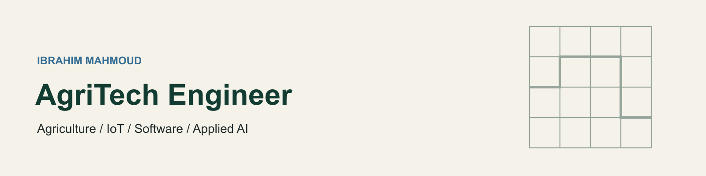

  

<h1 align="center">Ibrahim Mahmoud</h1>

<strong>Agricultural Engineer · Backend Developer · IoT & Edge Systems</strong>

Building the connection between field measurements and useful software.

  

  <a href="mailto:abrahimmahmoud5454@gmail.com">Email</a>
  &nbsp;·&nbsp;
  <a href="https://www.linkedin.com/in/ibrahim-mahmoud-83106a320/">LinkedIn</a>
  &nbsp;·&nbsp;
  <a href="https://github.com/ibrahim13135?tab=repositories">Public projects</a>
  &nbsp;·&nbsp;
  Cairo, Egypt

---

## About me

I'm an agricultural engineer and backend developer working at the intersection of **agriculture, embedded systems, and data**. My current work connects field sensors and ESP32 devices to Raspberry Pi gateways, local databases, APIs, and monitoring dashboards.

I work through the full path: understand the agricultural problem, connect the hardware, collect the measurements, and build software that makes the data usable. I pay particular attention to what happens when connectivity drops, a device restarts, or a reading arrives late.

**Current focus:** agricultural IoT, edge data collection, backend development, and farm traceability.

## What I'm building

### Agricultural IoT & Edge Monitoring

**Current engineering work · Selected implementation details; source code is private**

A local monitoring and control platform connecting wired soil probes, solar-powered ESP32 nodes, and a Raspberry Pi station.

- Integrating **RS485 / Modbus RTU** probes and **MQTT** telemetry.
- Developing local storage, delivery acknowledgements, persistent sample queues, and recovery behavior for interrupted connections.
- Building dashboards for sensor readings, historical charts, device state, diagnostics, and data exports.
- Working on signed device commands, firmware update workflows, and relay-control safeguards.
- Investigating field failures through device, broker, and station logs, with attention to power and network constraints.
- Documenting wiring, component choices, deployment steps, and hardware qualification.

**Stack:** TypeScript, Node.js, SQLite, MQTT, C/C++, ESP32, Raspberry Pi, Linux, Modbus RTU.

### [NileTrace — Agricultural Traceability](https://github.com/ibrahim13135/NileTrace)

**In development · Public repository**

A farm-to-port traceability application for Egyptian agricultural exporters, bringing farms, plots, harvest batches, processing records, quality checks, documents, and shipments into one workflow.

- Backend APIs with authentication, role-based access, and relational data models.
- QR-based batch traceability, PDF document generation, and dashboard views.
- Database migrations and a structure that separates API routes, models, and business logic.

**Stack:** Python, FastAPI, PostgreSQL, SQLAlchemy, Alembic, Streamlit, Docker.

### [IoT Precision Agriculture — Graduation Project](https://github.com/ibrahim13135/Graduation_Project)

**Public repository**

An earlier project combining agricultural monitoring and irrigation-control software. It forms part of my progression from backend development toward connected agricultural systems.

## ALX Software Engineering Projects

The foundations behind my current backend and IoT work: public training repositories and collaborative projects from the ALX software engineering curriculum.

| Project | What the repository covers |
| --- | --- |
| **[AirBnB Clone](https://github.com/ibrahim13135/AirBnB_clone)** · **[Version 2](https://github.com/ibrahim13135/AirBnB_clone_v2)** | Python command interpreter, models and tests; MySQL configuration, Flask views, and deployment exercises in v2. |
| **[Simple Shell](https://github.com/ibrahim13135/simple_shell)** | A C shell project with command parsing, PATH handling, and error handling. |
| **[printf](https://github.com/ibrahim13135/printf)** | A custom C formatted-output implementation and format-specifier handling. |
| **[Backend Python](https://github.com/ibrahim13135/alx-backend-python)** | Type annotations, async functions, async comprehensions, unit and integration testing. |
| **[Backend JavaScript](https://github.com/ibrahim13135/alx-backend-javascript)** | ES6, promises, classes, data manipulation, and TypeScript. |
| **[User Data & Authentication](https://github.com/ibrahim13135/alx-backend-user-data)** | Personal data, basic authentication, session authentication, and a user authentication service. |
| **[Backend Storage](https://github.com/ibrahim13135/alx-backend-storage)** | Advanced MySQL, NoSQL, and Redis exercises. |
| **[System Engineering & DevOps](https://github.com/ibrahim13135/alx-system_engineering-devops)** | Linux, shell, SSH, web servers, load balancing, HTTPS, monitoring, and debugging. |
| **[Backend Engineering](https://github.com/ibrahim13135/alx-backend)** | Pagination, caching, internationalization, and JavaScript queuing exercises. |

<strong>More ALX foundations & algorithms</strong>

- [Low-Level Programming](https://github.com/ibrahim13135/alx-low_level_programming) — C programming exercises.
- [Higher-Level Programming](https://github.com/ibrahim13135/alx-higher_level_programming) — Python and higher-level programming coursework.
- [Sorting Algorithms](https://github.com/ibrahim13135/sorting_algorithms) and [Binary Trees](https://github.com/ibrahim13135/binary_trees) — algorithm and data-structure projects.
- [Interview Practice](https://github.com/ibrahim13135/alx-interview) — coding interview exercises.
- [What Happens When](https://github.com/ibrahim13135/what-happens-when) — web infrastructure learning repository.

## Technical Skills

**Programming Languages**

     

**Backend Development**

    

**Databases & Storage**

    

**IoT & Edge Systems**

    

**DevOps & Tools**

    

**Engineering Practice**

   

## How I approach engineering

- **Start with the field requirement.** Sampling intervals, power availability, maintenance access, and connectivity shape the design.
- **Make data quality visible.** Distinguish measurement time from delivery time, missing readings from zeroes, and estimates from measured values.
- **Design for recovery.** Keep acquisition and delivery concerns clear, preserve stored samples, and test restart and outage behavior.
- **Make the work maintainable.** Keep implementation, diagnostics, documentation, and deployment instructions aligned.

<strong>Background & training</strong>

### Software engineering

**ALX Software Engineering — Backend Specialization**

Training and project work across Python, C, JavaScript, backend APIs, relational and non-relational databases, Linux, networking, web infrastructure, authentication, and debugging. Projects include the AirBnB clone series and an agricultural IoT graduation project.

### Agricultural and field experience

Experience in agricultural and public health engineering, including IPM programs, field diagnosis, preventive recommendations, and treatment documentation at **SOTAICO**.

Field training includes **ECS**, **Sedra Group**, and **Talaat Moustafa Group**, with exposure to crop health and irrigation. Earlier customer-service work at **Orange Egypt** and **Vodafone Egypt** strengthened my communication and technical-support skills.

## Let's connect

I'm interested in **AgriTech, backend, and IoT engineering opportunities** where agricultural knowledge and software development come together.

- **Email:** [abrahimmahmoud5454@gmail.com](mailto:abrahimmahmoud5454@gmail.com)
- **LinkedIn:** [Ibrahim Mahmoud](https://www.linkedin.com/in/ibrahim-mahmoud-83106a320/)
- **Location:** Cairo, Egypt · Open to remote collaboration
- **Languages:** Arabic and English
